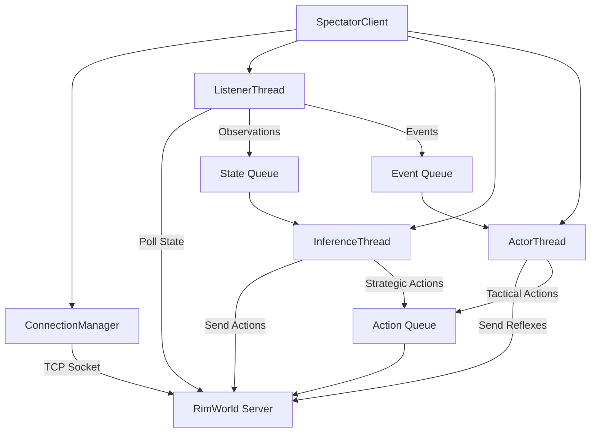

# Python Client API Overview

The Python client provides a high-level interface for interacting with RimWorld through the ML Bridge.

## Architecture



## Core Components

### ConnectionManager

`client.connection.ConnectionManager`

Manages TCP connection to RimWorld server with automatic reconnection.

**Key Methods:**

- `connect()`: Establish connection
- `send_command(cmd)`: Send protobuf command
- `receive_state()`: Receive protobuf state
- `close()`: Clean shutdown

**Example:**

```python
from client.connection import ConnectionManager

manager = ConnectionManager(
    host="localhost",
    port=50051,
    auto_reconnect=True,
    max_reconnect_attempts=10
)

await manager.connect()
state = await manager.send_command(QueryStateCommand())
```

### SpectatorClient

`client.spectator_client.SpectatorClient`

Main orchestrator managing all client threads.

**Key Methods:**

- `start()`: Start all threads
- `stop()`: Graceful shutdown
- `set_policy(executive, reflex)`: Configure policies
- `get_metrics()`: Get performance stats

**Example:**

```python
from client.spectator_client import SpectatorClient
from policies.executive import SimpleExecutive
from policies.reflex import CombatReflex

client = SpectatorClient(
    host="localhost",
    port=50051,
    mode="inference"  # or "training"
)

client.set_policy(
    executive=SimpleExecutive(),
    reflex=CombatReflex()
)

client.start()
# ... agent runs ...
client.stop()
```

### ListenerThread

`client.listener.ListenerThread`

Polls game state and detects events.

**Responsibilities:**

- Poll QUERY_STATE at configured intervals
- Detect state changes (damage, raids, fires)
- Populate state queue for Inference thread
- Populate event queue for Actor thread

**Configuration:**

```python
listener_config = {
    "poll_interval_ms": 100,  # Inference mode
    "training_mode": False,
    "reconnect_attempts": 10
}
```

### InferenceThread

`client.inference.InferenceThread`

Executes strategic policy (Executive).

**Responsibilities:**

- Consume latest state from queue
- Run Executive policy
- Generate high-level actions
- Update long-term strategy

**Latency Budget:** 10-100ms per decision

### ActorThread

`client.actor.ActorThread`

Executes tactical policy (Reflex).

**Responsibilities:**

- Monitor event queue
- Run Reflex policy
- Generate immediate tactical actions
- Override Executive when needed

**Latency Budget:** <10ms per response

## Policies

### Policy Base Class

`policies.policy.Policy`

Abstract base class for policies.

**Interface:**

```python
class Policy(ABC):
    @abstractmethod
    def decide(self, state: RichStateMessage) -> List[Action]:
        """Generate actions from game state."""
        pass
    
    @abstractmethod
    def on_event(self, event: Event) -> List[Action]:
        """React to game events."""
        pass
```

### ExecutivePolicy

`policies.executive.ExecutivePolicy`

Strategic planning policy.

**Example Implementation:**

```python
from policies.policy import Policy

class MyExecutive(Policy):
    def decide(self, state):
        actions = []
        
        # Assign idle colonists to tasks
        for colonist in state.colonists:
            if colonist.job.type == "Idle":
                actions.append(self.assign_task(colonist))
        
        return actions
```

### ReflexPolicy

`policies.reflex.ReflexPolicy`

Tactical response policy.

**Example Implementation:**

```python
from policies.policy import Policy

class CombatReflex(Policy):
    def on_event(self, event):
        if event.type == "RAID_STARTED":
            # Draft all available colonists
            return [DraftAction(c.id) for c in self.get_available_colonists()]
        return []
```

## Gymnasium Environment

### RimWorldEnv

`gym_env.rimworld_env.RimWorldEnv`

OpenAI Gymnasium-compatible environment wrapper.

**Usage with Stable-Baselines3:**

```python
from gym_env.rimworld_env import RimWorldEnv
from stable_baselines3 import PPO

env = RimWorldEnv(
    host="localhost",
    port=50051,
    mode="training"
)

model = PPO("MultiInputPolicy", env, verbose=1)
model.learn(total_timesteps=100_000)
model.save("rimworld_agent")
```

**Observation Space:**

- Colonist states (health, needs, skills, position)
- Map state (terrain, buildings, items)
- Global state (wealth, time, weather)

**Action Space:**

- Draft/undraft colonists
- Assign jobs
- Set priorities
- Build/attack commands

## Event System

### Event

Represents game events detected by Listener.

**Event Types:**

- `COLONIST_DAMAGED`: Pawn took damage
- `COLONIST_DIED`: Pawn died
- `RAID_STARTED`: Raiders spawned
- `FIRE_STARTED`: Fire broke out
- `MENTAL_BREAK`: Pawn mental break
- `JOB_COMPLETED`: Job finished

**Priority Levels:**

- `CRITICAL`: Immediate threats (combat, fire)
- `HIGH`: Important events (mental breaks)
- `MEDIUM`: Notable events (job completion)
- `LOW`: Minor events (mood changes)

**Example:**

```python
from client.events import Event, EventPriority

event = Event(
    type="RAID_STARTED",
    priority=EventPriority.CRITICAL,
    data={"raid_size": 5, "faction": "Pirate"}
)
```

## Metrics and Monitoring

### MetricsCollector

`client.metrics.MetricsCollector`

Collects performance metrics.

**Tracked Metrics:**

- Connection stats (reconnects, errors)
- Latency (observation, action, round-trip)
- Throughput (states/sec, actions/sec)
- Thread health (queue sizes, processing time)

**Usage:**

```python
metrics = client.get_metrics()

print(f"Observation latency: {metrics.observation_latency_ms}ms")
print(f"Actions sent: {metrics.total_actions_sent}")
print(f"Reconnects: {metrics.total_reconnects}")
```

## Best Practices

### Thread Safety

- Never share mutable state between threads
- Use queues for inter-thread communication
- Avoid blocking main thread

### Error Handling

```python
try:
    state = await manager.send_command(cmd)
except ConnectionError:
    logger.error("Connection lost, retrying...")
    await manager.reconnect()
except ProtobufDecodeError:
    logger.error("Invalid protobuf received")
```

### Performance

- Batch actions when possible
- Use delta compression for large states
- Monitor queue sizes to detect bottlenecks

### Logging

```python
import logging

logging.basicConfig(
    level=logging.INFO,
    format='[%(asctime)s] [%(threadName)s] %(levelname)s: %(message)s'
)
```

## Next Steps

- [Connection Management](connection.md)
- [Spectator Client](spectator.md)
- [Policy Development](policies.md)
- [Gymnasium Environment](gym-env.md)
