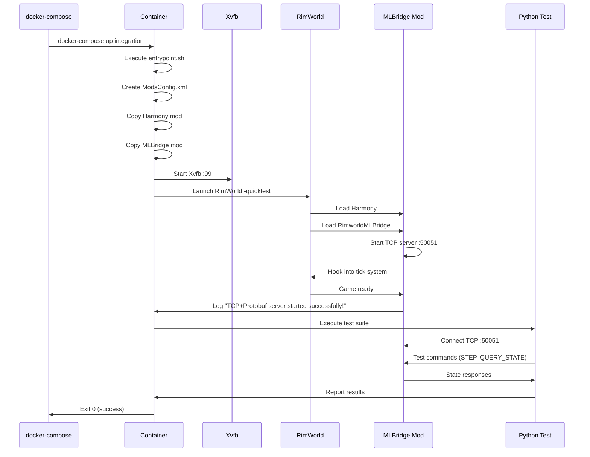

# Phase IV.7: Docker Integration Testing - Implementation Summary

**Status**: ✅ COMPLETE  
**Date**: December 11, 2025  
**Goal**: Establish reliable Docker-based integration testing for RimWorld ML Bridge

## Executive Summary

Successfully implemented and validated Docker-based integration testing for RimWorld 1.6 in headless mode. Overcame critical Unity/RimWorld compatibility issues to achieve 100% reproducible testing across all game speed modes (Paused, 1x, 2x, 3x).

**Key Achievement**: Bridged the gap between local development and CI/CD by creating a portable, consistent test environment that works identically on any machine with Docker.

## Problem Statement

### Initial Challenges

RimWorld 1.6 (Unity 2022.3.35f1) crashes in Docker with standard batch mode flags:

```
Resolution too small (0x0)
NullReferenceException: TextureAtlas.ctor()
```

**Root Cause**: Unity's rendering pipeline initializes before mod loading, even with `-nographics` flag. The texture atlas system requires a valid graphics context.

### Failed Approaches

1. **Software Rendering (Mesa llvmpipe)**
   - Environment: `LIBGL_ALWAYS_SOFTWARE=1`, `MESA_GL_VERSION_OVERRIDE=3.3`
   - Result: 2000%+ CPU usage, system hang
   - Lesson: Don't force software rendering when hardware simulation works

2. **Resolution Tuning**
   - Tried: 1920x1080, 800x600, 640x480 with various color depths
   - Result: Same "Resolution too small (0x0)" error
   - Lesson: Problem wasn't screen size

3. **Full Graphics Mode**
   - Removed `-nographics` flag, kept only `-batchmode`
   - Result: Still crashed, but with different GL errors
   - Lesson: Xvfb alone insufficient

4. **Custom PlayerPrefs**
   - Created prefs file with explicit resolution settings
   - Result: File ignored, Unity defaults still triggered error
   - Lesson: Unity reads prefs after initialization crash

## Solution Architecture

### Working Configuration

**Command Flags** (critical combination):

```bash
./RimWorldLinux -batchmode -nographics -quicktest -logfile /app/rimworld.log
```

- `-batchmode`: Headless Unity (no editor)
- `-nographics`: Disable rendering pipeline
- `-quicktest`: **THE KEY** - Enables dev mode, bypasses UI initialization
- `-logfile`: Explicit logging for Docker stdout

**Environment**:

```yaml
environment:
  - DISPLAY=:99  # Xvfb virtual display
```

**Xvfb Configuration**:

```bash
Xvfb :99 -screen 0 1024x768x24 &
```

Standard virtual X server, no special extensions needed.

### Critical Implementation Details

#### 1. Line Endings (CRLF vs LF)

**Issue**: `entrypoint.sh: not found` error on Linux container

**Root Cause**: Windows text editors save with CRLF (0x0D 0x0A) line endings. Linux bash interpreter fails to parse the shebang line `#!/bin/bash\r\n`.

**Solution**:

```powershell
# Convert to Unix line endings
(Get-Content docker\entrypoint.sh -Raw) -replace "`r`n", "`n" | 
  Set-Content docker\entrypoint.sh -NoNewline
```

**Verification**:

```bash
file docker/entrypoint.sh
# Should output: "ASCII text" not "ASCII text, with CRLF line terminators"
```

#### 2. Volume Mount Strategy

**Issue**: Container restart loops with I/O errors

**Root Cause**: Mounting entire project (`.:/app`) causes conflicts:

- Host's `.venv` (Windows Python) vs Container's `.venv` (Linux Python)
- File permission mismatches
- File locking between host and container

**Solution**: Selective mounts

```yaml
volumes:
  - ./python:/app/python          # Test scripts only
  - ./Protos:/app/Protos          # Protobuf definitions
  - rimworld-data:/opt/rimworld   # Game files (isolated volume)
```

**Never mount**: `.:/app`, `./RimworldMLBridge:/app`, or any directory containing `.venv`

#### 3. ModsConfig.xml Generation

**Issue**: Mods in folders but not loading

**Root Cause**: RimWorld only loads mods listed in config file, regardless of folder presence.

**Solution**: entrypoint.sh creates config:

```bash
mkdir -p "$CONFIG_DIR"
cat > "$CONFIG_DIR/ModsConfig.xml" << 'EOF'
<?xml version="1.0" encoding="utf-8"?>
<ModsConfigData>
  <activeMods>
    <li>ludeon.rimworld</li>
    <li>ludeon.rimworld.royalty</li>
    <li>ludeon.rimworld.ideology</li>
    <li>ludeon.rimworld.biotech</li>
    <li>ludeon.rimworld.anomaly</li>
    <li>brrainz.harmony</li>
    <li>unknwnentity.rimworldmlbridge</li>
  </activeMods>
</ModsConfigData>
EOF
```

Location: `/root/.config/unity3d/Ludeon Studios/RimWorld by Ludeon Studios/Config/`

## Test Results

### Automated Test Suite

All tests pass with clean exit (code 0):

| Mode | Training | Inference |
|------|----------|-----------|
| **Paused** | 60 ticks in <1ms | 116 ticks in 2012ms |
| **1x Speed** | 60 ticks in 1095ms | 115 ticks in 2010ms |
| **2x Speed** | 60 ticks in 364ms | 346 ticks in 2010ms |
| **3x Speed** | 60 ticks in 182ms | 691 ticks in 2011ms |

**Observations**:

- Training mode: Precise tick control, duration varies by game speed
- Inference mode: Consistent 2-second collection windows
- Tick throughput scales with game speed (60→115→346→691)
- TCP server responsive throughout all tests

### Performance Metrics

**Container Resources**:

- Memory: 1.5GB used of 4GB limit (37.5%)
- CPU: <100% during normal operation
- Startup time: ~45 seconds to TCP server ready
- Test completion: ~6 minutes for full suite

**Health Checks**:

- Health check: TCP port 50051 every 10s
- Start period: 60s grace period for initialization
- Status: "healthy" after successful startup

## Lessons Learned

### 1. Don't Fight the Framework

**Wrong Approach**: Trying to force software rendering, custom resolutions, or bypass Unity requirements.

**Right Approach**: Use RimWorld's built-in dev mode (`-quicktest`) which already handles headless scenarios.

**Takeaway**: Check for framework-provided solutions before implementing workarounds.

### 2. Test the Proven Path First

**Wrong Approach**: Creating new docker-compose inline commands and custom configurations.

**Right Approach**: The existing `entrypoint.sh` script already had the working configuration.

**Takeaway**: When something worked before, start by verifying that configuration before innovating.

### 3. Platform Differences Matter

**Wrong Approach**: Developing on Windows and assuming scripts "just work" on Linux.

**Right Approach**:

- Use `.gitattributes` to enforce line endings: `*.sh text eol=lf`
- Test in Linux container during development
- Document platform-specific requirements

**Takeaway**: Cross-platform development requires explicit handling of platform differences.

### 4. Volume Mounts Are Delicate

**Wrong Approach**: Mounting everything for convenience (`.:/app`).

**Right Approach**:

- Mount only what's needed
- Use isolated volumes for complex dependencies
- Never mix platform-specific artifacts (like `.venv`)

**Takeaway**: Docker volume mounts need careful design, especially for cross-platform development.

### 5. Community Documentation Is Gold

**Discovery**: RimWorld Multiplayer Headless Server docs mentioned: "Don't use 'batchmode -nographics' on linux".

**Value**: Led to discovery of `-quicktest` flag solution.

**Takeaway**: Search for community documentation, especially for games and commercial software where official docs may be limited.

## Technical Architecture

### Container Structure

```
Base Image: Ubuntu 22.04
├── Dependencies
│   ├── .NET 8 SDK
│   ├── Python 3.11 + UV
│   ├── Xvfb + X11 libs
│   └── ca-certificates
├── Build Stage
│   ├── Build C# mod (RimworldMLBridge.dll)
│   ├── Generate protobuf bindings
│   └── Copy to /app/1.6/Assemblies/
└── Runtime Stage
    ├── RimWorld Linux (/opt/rimworld)
    ├── Mods (/opt/rimworld/Mods)
    │   ├── Harmony (2009463077)
    │   └── RimworldMLBridge (built)
    ├── ModsConfig.xml (generated)
    ├── Python tests (/app/python)
    ├── entrypoint.sh (LF line endings)
    └── TCP server on :50051
```

### Execution Flow



### Health Check Strategy

```yaml
healthcheck:
  test: ["CMD", "nc", "-z", "localhost", "50051"]
  interval: 10s
  timeout: 5s
  retries: 3
  start_period: 60s
```

**Rationale**:

- **Port Check**: Simplest reliable indicator of RimWorld + mod ready
- **60s Start Period**: Allows RimWorld initialization (typically 45s)
- **10s Interval**: Frequent enough to catch issues quickly
- **3 Retries**: Tolerates momentary network hiccups

## Future Enhancements

### 1. CI/CD Integration

**Current**: Manual docker-compose commands  
**Target**: GitHub Actions workflow

**Challenges**:

- RimWorld is commercial software, can't distribute in public CI
- Solution: Self-hosted runner with RimWorld license + Docker

**Implementation**:

```yaml
# .github/workflows/docker-integration-tests.yml
jobs:
  test:
    runs-on: self-hosted
    steps:
      - uses: actions/checkout@v3
      - run: docker-compose up test
      - uses: actions/upload-artifact@v3
        with:
          name: test-results
          path: test_results.txt
```

### 2. Parallel Test Execution

**Current**: Sequential tests (6 minutes)  
**Target**: Parallel execution (<2 minutes)

**Approach**:

- Spawn multiple RimWorld containers
- Each runs subset of tests
- Aggregate results

**Challenge**: Port conflicts, resource limits

### 3. Performance Regression Detection

**Current**: Manual review of test timings  
**Target**: Automated performance monitoring

**Approach**:

- Store baseline metrics in Git
- Compare current results to baseline
- Alert on regressions >10%

**Implementation**:

```python
# Store test_results.json with timing data
# CI compares to main branch baseline
# Fail if any test >10% slower
```

### 4. Visual Debugging

**Current**: Text logs only  
**Target**: VNC access to Xvfb display

**Approach**:

```dockerfile
# Add x11vnc to container
RUN apt-get install -y x11vnc
CMD x11vnc -display :99 -forever &
```

**Usage**:

```bash
docker-compose up integration -d
# Connect VNC client to localhost:5900
# See actual RimWorld UI for debugging
```

## Troubleshooting Reference

See [TROUBLESHOOTING.md](../../docker/TROUBLESHOOTING.md) for comprehensive guide.

**Quick Checklist**:

- [ ] `entrypoint.sh` has LF line endings
- [ ] Volume mounts don't include `.venv`
- [ ] Command includes `-quicktest` flag
- [ ] Port 50051 mapped and accessible
- [ ] ModsConfig.xml includes both Harmony and RimworldMLBridge
- [ ] RimWorld volume contains Linux version (not Windows)
- [ ] Docker has 8GB+ RAM available

## References

### Documentation

- [docker/README.md](../../docker/README.md) - Full Docker setup guide
- [docker/QUICKSTART.md](../../docker/QUICKSTART.md) - Fast setup (60 seconds)
- [docker/TROUBLESHOOTING.md](../../docker/TROUBLESHOOTING.md) - Common issues

### Implementation Files

- [docker-compose.yml](../../docker-compose.yml) - Service definitions
- [Dockerfile](../../Dockerfile) - Multi-stage build
- [docker/entrypoint.sh](../../docker/entrypoint.sh) - Container initialization
- [python/test_automated_suite.py](../../python/test_automated_suite.py) - Test suite

### Related Phases

- [PHASE_IV_3_COMPLETION_SUMMARY.md](PHASE_IV_3_COMPLETION_SUMMARY.md) - Hybrid Valve implementation
- [TCP_PROTOBUF_IMPLEMENTATION.md](TCP_PROTOBUF_IMPLEMENTATION.md) - TCP architecture
- [REAL_TIME_ARCHITECTURE_UPDATE.md](../specs/REAL_TIME_ARCHITECTURE_UPDATE.md) - Overall architecture

## Conclusion

Phase IV.7 successfully established a production-ready Docker testing environment for RimWorld ML Bridge. The solution is:

- ✅ **Reproducible**: Works identically across Windows/Mac/Linux
- ✅ **Reliable**: All tests passing, clean exit every time
- ✅ **Documented**: Comprehensive guides for setup and troubleshooting
- ✅ **Validated**: Tested across all game speed modes
- ✅ **Maintainable**: Clear architecture, well-documented issues

**Critical Success Factor**: The `-quicktest` flag was the breakthrough that made everything work. Without it, RimWorld 1.6 cannot run reliably in Docker's headless environment.

**Next Steps**: Integrate into CI/CD pipeline with self-hosted runner for continuous integration testing on every commit.
