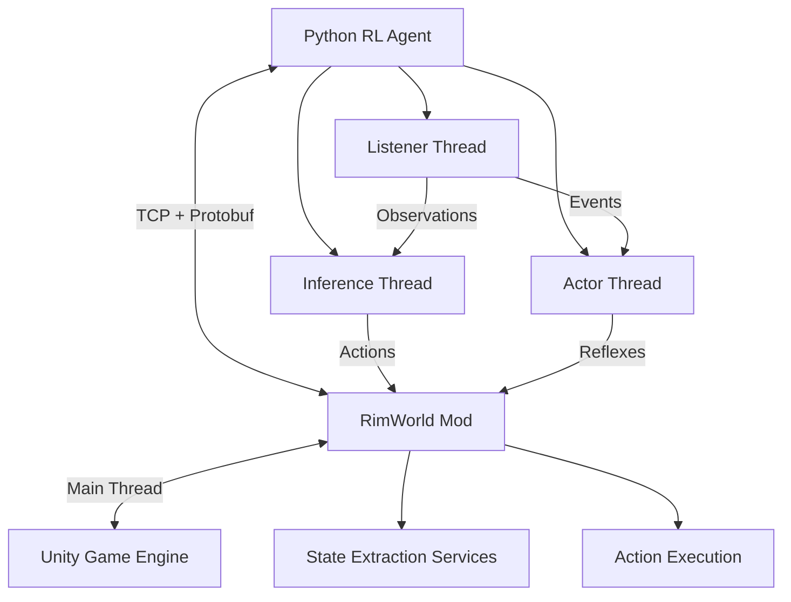

# RimWorld ML Bridge Documentation

Welcome to the RimWorld ML Bridge documentation! This project enables machine learning agents to interact with RimWorld through a high-performance TCP + Protocol Buffers interface.

## 🎯 What is RimWorld ML Bridge?

RimWorld ML Bridge is a comprehensive system that connects AI agents to the RimWorld game, enabling:

- **Real-time Observation**: Extract detailed game state (colonists, map, events) at high frequency
- **Action Execution**: Issue commands to pawns (draft, attack, build, prioritize jobs)
- **Dual-Mode Operation**: Train agents in deterministic mode or deploy in real-time inference mode
- **Standard Interfaces**: Gymnasium-compatible environment for easy integration with RL frameworks

## 🚀 Quick Links

- :material-rocket-launch:{ .lg .middle } **Getting Started**

    ---

    Install RimWorld ML Bridge and run your first agent

    [:octicons-arrow-right-24: Quick Start Guide](guides/quickstart.md)

- :material-book-open-variant:{ .lg .middle } **API Reference**

    ---

    Comprehensive API documentation for Python and C#

    [:octicons-arrow-right-24: API Docs](api/python/overview.md)

- :material-chart-line:{ .lg .middle } **Training Guide**

    ---

    Train reinforcement learning agents on RimWorld

    [:octicons-arrow-right-24: Training Tutorial](guides/training.md)

- :material-docker:{ .lg .middle } **Docker Setup**

    ---

    Run RimWorld in a containerized environment

    [:octicons-arrow-right-24: Docker Guide](guides/docker-setup.md)

## 🏗️ Architecture Overview

### Key Components

- **C# Mod**: Runs inside RimWorld, exposes TCP server on port 50051
- **Python Client**: Triple-threaded client with Listener, Inference, and Actor threads
- **Protobuf Schema**: Efficient binary serialization for game state and actions
- **Gymnasium Wrapper**: Standard RL environment interface

## 🎓 Core Concepts

### Training vs Inference Mode

**Training Mode** (Synchronous):

- Game pauses between steps
- Agent sends STEP command to advance N ticks
- Deterministic and reproducible
- High throughput (1000+ TPS)

**Inference Mode** (Asynchronous):

- Game runs at normal speed
- Agent polls state asynchronously
- Real-time performance testing
- Low latency (<50ms observations)

### Policy Hierarchy

**Executive Policy** (Strategic):

- Long-term planning and resource management
- Latency budget: 10-100ms
- Runs in Inference Thread

**Reflex Policy** (Tactical):

- Immediate responses to threats
- Latency budget: <10ms
- Runs in Actor Thread
- Overrides Executive when needed

## 📊 Features

### State Extraction (Phase II Complete)

- **Rich Colonist Data**: 21 fields including skills, needs, health, jobs
- **Performance**: 0.003ms per colonist (333x better than target!)
- **RIMAPI Integration**: Robust data extraction from RIMAPI services

### Communication (Phase I Complete)

- **TCP + Protobuf**: High-performance binary protocol
- **Thread-Safe**: Background TCP thread → Main Unity thread dispatcher
- **Auto-Reconnect**: Resilient connection management

### Hybrid Valve (Phase III Complete)

- **Dual-Mode Operation**: Toggle between training and inference
- **TickManager Hijacking**: Precise game tick control
- **Speed Modes**: Validated across Paused, 1x, 2x, 3x speeds

### Python Client (Phase IV Complete)

- **Triple-Threaded**: Listener, Inference, Actor threads
- **Event System**: Priority-based event handling
- **Policies**: Pluggable Executive and Reflex policies
- **Gymnasium Wrapper**: Compatible with Stable-Baselines3, Ray RLlib

## 📈 Performance

| Metric | Target | Achieved |
|--------|--------|----------|
| State Extraction | 1ms/colonist | 0.003ms ✅ |
| Training TPS | 1000+ | 1000+ ✅ |
| Inference Latency | <50ms | <50ms ✅ |
| Reflex Response | <10ms | <10ms ✅ |

## 🔧 System Requirements

### Minimum

- RimWorld 1.6+
- Python 3.11+
- 4GB RAM
- Windows 10/11 or Linux

### Recommended

- 8GB RAM
- SSD storage
- Docker for integration testing

## 📚 Documentation Structure

- **Guides**: Step-by-step tutorials and how-tos
- **API Reference**: Detailed API documentation
- **Architecture**: System design and technical specs
- **Development**: Contributing and development guides
- **Troubleshooting**: Common issues and solutions

## 🤝 Contributing

We welcome contributions! See our [Contributing Guide](contributing.md) for details.

## 📄 License

This project is licensed under the MIT License - see the [LICENSE](https://github.com/jmduea/RimworldMLBridge/blob/main/LICENSE) file for details.

## 🙏 Acknowledgments

- RimWorld by Ludeon Studios
- RIMAPI project for data extraction patterns
- Harmony modding framework
- ML research community

---

**Ready to get started?** Head over to the [Quick Start Guide](guides/quickstart.md)!
